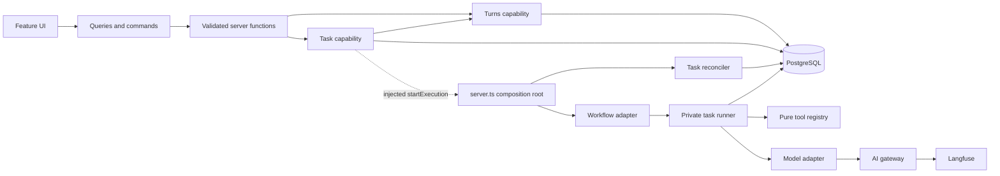

# Application template architecture

An implementation contract for the TanStack Start application bundled under `assets/template/`. The target is a small, working application whose synchronous and durable asynchronous features teach coding agents patterns they can safely extend. The template exists to get MVPs running fast, so it ships only the machinery its two reference features use. Everything else is a [deferred extension](#deferred-extensions) with its trigger written down.

**Status:** proposed architecture, not an implemented or runtime-verified template. How this design was chosen and revised, and how it answers findings F1 to F10, is recorded in [the architecture review](ARCHITECTURE-REVIEW.md#template-architecture-synthesis-and-revisions). This document proposes a replacement for overlapping template policies in [the earlier architecture](ARCHITECTURE.md); it does not silently change that document. On adoption, the generated template ships one architecture README and removes conflicting older summaries.

**Scope:** application code, database, runtime bindings, tests, CI, and deployment to already selected application environments. The surrounding provisioning system, Touch Grass installer, repository creation, provider account/resource acquisition, environment reconciliation, and Codex Cloud setup are deferred.

**Stack:** TanStack Start, React, TypeScript, TanStack Query, Supabase PostgreSQL/Auth/Storage, Cloudflare Workers and Workflows. Keep pinned versions, a lockfile, Oxlint with vendored anti-slop, dependency-cruiser, Vitest, and Playwright. Cloudflare Free and Supabase Free remain feasibility targets, subject to measured acceptance.

**External requirements:** paid inference, production SMTP, an OpenAI-compatible AI gateway (LiteLLM or equivalent), and Langfuse. The gateway enforces spend, token, and provider rate limits per environment key **and per end user**, and forwards traces to Langfuse. The template keeps no money or token ledger of its own. A gateway that cannot enforce per-user budgets does not meet the requirement, because one user could otherwise exhaust every user's budget.

## Problem

Submission, execution, cancellation, and provider calls cross systems that cannot commit one transaction together. A lost response cannot tell the caller whether work happened. Two workers can observe the same apparent capacity. A stopped Workflow does not prove an external request stopped. Directory conventions cannot resolve those facts.

Start with the application promises and choose their arbitration points. PostgreSQL owns user-visible facts and the shared counters, so it also authorizes task progress. Workflows provide durable steps and wakeups. Model calls are recorded before they are sent. The AI gateway owns spend. Each boundary has one owner, and callers ask that owner to complete an operation instead of coordinating its internals.

Workflows earn their place over a database-only loop driven by the reconciler. A Workflow continues to the next step immediately and sleeps durably for backoff, so a task's steps are not paced by a one-minute cron tick. The reconciler stays as the recovery path for dispatch and lost executions, not as the execution engine.

## Usage

These are caller sketches for the future template. The commands and APIs below do not exist in this checkout yet.

The browser submits through a typed server-function wrapper. It creates one request key for a deliberate submission and retains that key across transport retries. Queries poll persisted task views and reconcile command responses into the cache.

```ts
const receipt = await submitTask({ data: { requestKey, instructions } });
if (receipt.kind === 'accepted') {
  await queryClient.invalidateQueries(taskQuery(receipt.task.id));
} else if (receipt.kind === 'refused') {
  showSubmissionRefusal(receipt.reason);
} else {
  showChangedSubmissionError(); // Same key was used for different input.
}
```

The RPC handler parses input, obtains an authenticated actor, and invokes the feature's task capability. Owner IDs never come from browser fields. Listing, reading, canceling, and retrying authorize the same way.

```ts
return tasks.submit(actor, parsedSubmission);
const page = await tasks.list(actor, { after: cursor });
const view = await tasks.read(actor, taskId, { transcript: turnCursor });
// Cancellation returns the actual durable winner, including an already completed task.
const canceled = await tasks.cancel(actor, taskId);
// An explicit retry creates a new linked task and preserves the old terminal outcome.
const retried = await tasks.retry(actor, failedTaskId, newRequestKey);
```

Only the Workflow adapter handles Cloudflare's step object. The cursor is a sequence number that only makes step names unique; the runner loads all progress from PostgreSQL on every call.

```ts
let cursor: Cursor = { seq: 0 };
for (;;) {
  const next = await step.do(`advance-${cursor.seq}`, STEP_CONFIG, () => runner.advance(executionId, cursor));
  if (next.kind === 'stop') return;
  if (next.kind === 'wait') await step.sleepUntil(`wait-${cursor.seq}`, new Date(next.until));
  cursor = next.cursor;
}
```

The synchronous `agent-turns` feature creates, lists, and renders persisted turns. It never calls a model. The same renderer shows a task's transcript, because each committed task step writes one agent turn.

```ts
const result = await createTurn({ data: { requestKey, blocks } });
if (result.kind === 'key_conflict') showChangedSubmissionError();
const transcript = await turns.list(actor, { taskId, after: cursor });
```

## First principles and ownership

| Promise | Structural decision |
|---|---|
| An accepted submission survives a lost HTTP response. | Commit its receipt, task, attempt, and slot together before starting a Workflow. |
| One durable outcome wins cancellation/completion races. | Both contend on the same task row; terminal outcomes are immutable. |
| A stale or canceled runner cannot publish anything. | Every runner write, including the agent turn, commits in one transaction that checks the task's active attempt, its token, and the task state. |
| At most one send per task is live at the adapter. | A send is authorized only for the active attempt; SQL keeps the attempt lease beyond every in-flight send's deadline, so a successor cannot exist while a sender may still run. |
| Concurrent submissions cannot each take the last execution slot. | Count active attempts per user and environment atomically in PostgreSQL. |
| Spend and token budgets hold across every model call and every user. | All model calls go through the AI gateway with the owner's user ID; the gateway owns those budgets. |
| Storage stays bounded per user. | Per-user rate limits on submissions and turn creation, and size caps on every stored payload. |
| Synchronous and asynchronous features share one transcript model. | `agent-turns` owns content blocks and turn storage; the task feature writes agent turns only through one turns-owned SQL routine. |
| A feature's caller need not understand its execution machinery. | Expose domain operations; keep persistence and runtime interfaces private. |
| A valid source import may disappear during compilation. | Check ownership in source and client reachability after the real TanStack transform. |
| Agents need one answer about legality and completion. | Derive mechanical checks and command profiles from one policy source. |

PostgreSQL owns turn, task, attempt, step, and send facts. Workflow checkpoints cache execution recovery, never a second task status. The query cache is a client replica. Langfuse is an observability replica fed by the gateway, never a source of task truth.



The arrows describe effects through the owning capability and repository. They do not grant adapters direct database access. `TASKS --> TURNS` is a read through the turns API; the runner's turn write happens inside a task routine in SQL.

## Module map

All paths in this map are relative to the generated application root. Add files only when the responsibility is present.

```text
src/
  routes/                             URLs, loaders, protected layouts
  features/
    auth/                             Auth screens and server functions
    account/                          Profiles and account behavior
    agent-turns/
      ui/                             Turn page, exhaustive block renderers
      agent-turns.queries.ts          Keys, fetching, pagination
      agent-turns.commands.ts         Create and cache reconciliation
      agent-turns.functions.ts        Client-importable RPC wrappers
      agent-turns.schema.ts           ContentBlock, StoredBlock, Turn, size caps (public)
      agent-turns.api.server.ts       Create and list (public)
      agent-turns.repo.server.ts      Row parsing and persistence
      agent-turns.e2e.spec.ts         User-visible journey
    agent-tasks/
      ui/                             Submission, progress, outcomes
      agent-tasks.queries.ts          Keys, fetching, polling
      agent-tasks.commands.ts         Mutation and cache reconciliation
      agent-tasks.functions.ts        Client-importable RPC wrappers
      agent-tasks.schema.ts           Client-safe schemas and views
      agent-tasks.api.server.ts       The five task use cases, with real behavior
      agent-tasks.model.ts            Private pure decisions and domain model
      agent-tasks.tools.ts            Pure tool registry (no server or runtime imports)
      agent-tasks.runtime.server.ts   Runner and bounded reconciliation
      agent-tasks.repo.server.ts      Row parsing and atomic persistence
      agent-tasks.workflow.server.ts  Cloudflare steps, waits, payload parsing
      agent-tasks.*.test.ts           Consequential feature tests
      agent-tasks.e2e.spec.ts         User-visible journey
  components/{ui,patterns}/           Shared primitives and compositions
  platform/
    ids.ts                            Brands for identities shared across features
    model.server.ts                   OpenAI-compatible gateway adapter and outcome classification
    timing.ts                         Execution timing constants and their nesting assertions
    ...                               Generic auth, DB, env, logging
  server.ts                           Sole runtime composition root
supabase/
  schemas/<owner>/                    Tables, policies, constraints, routines
  migrations/                         One ordered deployment ledger
  tests/                              Global database security checks
architecture/policy.ts                Ownership rules and verification profiles
tests/architecture/                   Positive and negative build fixtures
tools/                                Policy and verification commands
AGENTS.md                             Short conditional navigation
```

Each feature's `api.server.ts` is its public boundary and implements its use cases. Do not add a forwarding service or barrel beside it. The task runtime module implements `advance` and reconciliation using the same model and repository. Its exports are visible only to the owning Workflow adapter and composition root.

Feature dependencies point one way. `agent-tasks` may import `agent-turns.schema.ts` and `agent-turns.api.server.ts`. `agent-turns` never imports `agent-tasks`. Identities that both features name, such as `UserId`, `TaskId`, and `TurnId`, live in `platform/ids.ts`, so a turn can carry a `TaskId` without depending on the task feature. Other features may import public domain contracts and APIs, never private models or repositories. Reject feature cycles. Create `domain/<capability>/` only for an independently shared business capability.

The same direction holds in SQL. Only `task_api.commit_step` can write an agent turn, through the grant boundary described in [Runtime parsing and authorization](#runtime-parsing-and-authorization). The policy file declares this edge, and the database security tests prove it.

`platform/` contains mechanisms and has no imports from features. The model adapter speaks the OpenAI-compatible gateway protocol and knows nothing about tasks. Only `src/server.ts` registers feature Workflow classes and the scheduled reconciler. It also injects a `startExecution(executionId)` function into the task API and reconciler, so submission can nudge execution without importing runtime code. This exception names one file, not the platform directory. The entrypoint wires dependencies and delegates; it contains no task rules.

The tool registry module may import only its schemas and other pure modules. A dependency rule bans server, platform, and runtime imports from it, and a lint rule bans I/O globals such as `fetch`, `caches`, and environment bindings inside it. Purity is enforced by those checks, not by the `PureTool` type, which cannot express it.

Keep the existing responsibility distinction between UI, queries, commands, RPC, domain decisions, persistence, and durable execution. Merge adjacent files when they would only repeat arguments and methods. A boundary earns a file by hiding policy, adapting a system, or enforcing ownership.

## Domain contracts

The following type sketch is a design contract. Boundary schemas and the remaining value types (`Actor`, `Submission`, `SubmissionRefusal`, `PublicActivity`, `NotFound`, `Instructions`, `TaskPolicy`, `ToolCatalog`, `SafeFailureCode`, `JsonValue`, `Schema`) are defined in the owning feature's schema module. Public views use serializable values. Database rows, framework objects, and provider DTOs remain private.

```ts
// platform/ids.ts
type Brand<T, Name extends string> = T & { readonly __brand: Name };
type UserId = Brand<string, 'UserId'>;
type TurnId = Brand<string, 'TurnId'>;
type TaskId = Brand<string, 'TaskId'>;
type RequestKey = Brand<string, 'RequestKey'>;
type Instant = Brand<string, 'IsoInstant'>;
type PageCursor = Brand<string, 'PageCursor'>; // Opaque encoding of the list's sort key.
type Page<T> = { items: readonly T[]; next?: PageCursor };

// agent-turns: public.
type ToolCallId = Brand<string, 'ToolCallId'>;
type ContentBlock =
  | { kind: 'text'; text: string }
  | { kind: 'tool_call'; callId: ToolCallId; tool: string; input: JsonValue | { unparsed: string } }
  | { kind: 'tool_result'; callId: ToolCallId; output: JsonValue; isError: boolean }
  | { kind: 'structured_output'; schema: string; value: JsonValue };
type StoredBlock = ContentBlock | { kind: 'unsupported'; storedKind: string; storedVersion: number };
type Turn = {
  id: TurnId; owner: UserId; role: 'user' | 'agent';
  blocks: readonly StoredBlock[]; taskId?: TaskId; createdAt: Instant;
};
type TurnReceipt =
  | { kind: 'stored'; turn: Turn }
  | { kind: 'key_conflict' }
  | { kind: 'rate_limited'; retryAfter: Instant };
interface Turns {
  create(actor: Actor, input: { requestKey: RequestKey; blocks: readonly ContentBlock[] }): Promise<TurnReceipt>;
  list(actor: Actor, query: { taskId?: TaskId; after?: PageCursor }): Promise<Page<Turn>>;
}

// agent-tasks: public.
type PublicTask = { id: TaskId; instructions: Instructions; retryOf?: TaskId; version: number } & (
  | { state: 'queued' }
  | { state: 'running'; committedSteps: number }
  | { state: 'completed'; finalTurn: TurnId; endedAt: Instant }
  | { state: 'failed'; failure: TaskFailure; endedAt: Instant }
  | { state: 'canceled'; endedAt: Instant }
);
type TaskFailure =
  | { kind: 'execution'; code: SafeFailureCode }
  | { kind: 'limit'; limit: 'attempts' | 'steps' | 'tool_calls' | 'sends' | 'context' | 'duration' }
  | { kind: 'gateway_refused'; reason: 'budget' | 'policy' | 'configuration' }
  | { kind: 'model_output_invalid'; reason: 'truncated' | 'oversized' };
type TaskView = { task: PublicTask; transcript: Page<Turn>; activity: readonly PublicActivity[] };
type SubmissionReceipt =
  | { kind: 'accepted'; task: PublicTask }
  | { kind: 'refused'; reason: SubmissionRefusal } // Includes capacity and rate limit.
  | { kind: 'key_conflict' };
interface Tasks {
  submit(actor: Actor, input: Submission): Promise<SubmissionReceipt>;
  list(actor: Actor, page: { after?: PageCursor }): Promise<Page<PublicTask>>;
  read(actor: Actor, id: TaskId, page: { transcript?: PageCursor }): Promise<TaskView | NotFound>;
  cancel(actor: Actor, id: TaskId): Promise<TaskView | NotFound>;
  retry(actor: Actor, id: TaskId, key: RequestKey): Promise<SubmissionReceipt | NotFound>;
}

// agent-tasks: private.
type AttemptId = Brand<string, 'AttemptId'>;
type ExecutionId = Brand<string, 'ExecutionId'>;
type Cursor = { seq: number };
type Prompt = { messages: readonly ProviderMessage[]; tools: readonly ToolSpec[]; digest: string; builderVersion: string };
type ModelResponse = { blocks: readonly ContentBlock[]; usage: { inputTokens: number; outputTokens: number } };
type ModelOutcome =
  | { kind: 'response'; response: ModelResponse }
  | { kind: 'retryable'; retryAfter?: Instant }
  | { kind: 'terminal'; failure: TaskFailure };
type Send = { ordinal: number; attempt: AttemptId; promptDigest: string; deadline: Instant } & (
  | { state: 'in_flight' }                              // `lost` is derived: in_flight and now >= deadline.
  | { state: 'observed'; observedAt: Instant; outcome: ModelOutcome }
);
type RunSnapshot = {
  now: Instant; deadline: Instant; policy: TaskPolicy; attempt: { id: AttemptId; token: number };
  instructions: Instructions;
  history: readonly Turn[];            // This task's committed agent turns, in step order.
  openStep?: { ordinal: number; sends: readonly Send[] };
};
type Decision =
  | { kind: 'send'; step: number; prompt: Prompt }
  | { kind: 'wait'; until: Instant }
  | { kind: 'commit_step'; step: number; response: ModelResponse; final: boolean }
  | { kind: 'fail'; failure: TaskFailure };
type Advance =
  | { kind: 'checkpoint'; cursor: Cursor }
  | { kind: 'wait'; until: Instant; cursor: Cursor }
  | { kind: 'stop' };
interface Runner {
  advance(execution: ExecutionId, cursor: Cursor): Promise<Advance>;
}
type PureTool<I, O> = { name: string; input: Schema<I>; output: Schema<O>; run(input: I): O };
function decide(snapshot: RunSnapshot, tools: ToolCatalog): Decision {
  throw new Error('not implemented');
}
function buildPrompt(instructions: Instructions, history: readonly Turn[], tools: ToolCatalog): Prompt {
  throw new Error('not implemented');
}
```

`PublicActivity` is derived from attempt, step, and send rows for display; there is no separate event log. `version` increases on every change to the task row and exists for client cache reconciliation; runner writes are fenced by the attempt token, not by version. Runtime schemas own application shapes and infer their types. Generated database types describe SQL storage; repository mappers parse storage into these domain contracts. Branded IDs are constructed by parsers, not casts in callers. Task lists sort by `(created_at, id)` descending; turn lists for a task sort by step ordinal, and user turns by `(created_at, id)`.

A **turn** is an ordered, owned list of content blocks with a role. A `tool_result` must reference a `tool_call` in the same turn; the write schema enforces that pairing. An **attempt** is one bounded execution-ownership period with its own ID, ordinal, execution ID, lease, token, and ended outcome. The task row names its active attempt, and the attempt's token increases with every fenced write, so two concurrent `advance` calls in one attempt cannot both commit. A **step** is one model response plus the pure tool calls it requested, committed as one agent turn. A **send** is one transmission of a step's prompt to the gateway. A step has one or more sends, and at most one send per step is accepted as its response.

### The agent loop

`decide` is pure. The runner loads a `RunSnapshot` from PostgreSQL, including the database's `now`, and applies exactly one decision per `advance`. The rows are checked in order.

| Snapshot | Decision |
|---|---|
| `now` at or past the task deadline | `fail` with `limit: 'duration'`. |
| No open step | `send` for step N+1, unless the step limit is exhausted (`fail` with `limit: 'steps'`) or the prompt exceeds the context limit (`fail` with `limit: 'context'`). |
| Open step, latest send `in_flight` and before its deadline, from any attempt | `wait` until that deadline. |
| Open step, latest send lost (`in_flight` and past its deadline) | `send` again, unless the step's send limit is exhausted (`fail` with `limit: 'sends'`). |
| Open step, latest send `retryable`, before `observedAt + backoff(ordinal)` or its `retryAfter` | `wait` until the later of those. |
| Open step, latest send `retryable`, after that time | `send` again, under the same send limit. |
| Open step, latest send `terminal` | `fail` with that send's failure. |
| Open step, a send observed as `response` | `commit_step`. `final` is true when the response requests no tools. |

Every committed turn has all its tool calls resolved, because `commit_step` runs them before writing the turn. So "no open step" always means the next action is a model call.

The runner maps decisions to transactions and Advance results.

| Decision | Inside one `advance` | Advance |
|---|---|---|
| `send` | Transaction 1 (fenced): open the step if absent, insert an `in_flight` send with deadline `db_now + SEND_TIMEOUT` and the prompt digest, and extend the lease. It returns the remaining time, and the adapter aborts the gateway call after that time minus a skew margin, so no absolute clock comparison happens in the Worker. Transaction 2: record the observation, retried in-process on transient database errors. | `checkpoint` |
| `wait` | Fenced transaction extends the lease to cover the wake time. | `wait` |
| `commit_step` | Run the requested pure tools inline. Then one fenced transaction calls `task_api.commit_step`: write the agent turn, close the step, and, when `final`, complete the task with `finalTurn` set and release the slot. | `checkpoint`, or `stop` when final |
| `fail` | Fenced transaction sets the terminal failure, ends the attempt, and releases the slot. | `stop` |

A fenced transaction requires that the attempt is the task's active attempt, the task is nonterminal, and the attempt token equals the snapshot's token. It increments the token. Rejections map to one result each.

| Rejection | Advance |
|---|---|
| Attempt not active, or task terminal | `stop`. The runner writes nothing more. |
| Stale token, or a unique-key conflict on step, send, or turn | `checkpoint`. The next `advance` re-reads the snapshot. |
| Task deadline passed | A fenced `fail` with `limit: 'duration'`, then `stop`. |

Transaction 2 is not token-fenced, so a concurrent `wait` in the same attempt cannot discard a response that already arrived. It records the observation only if the send is the latest for its step, is still `in_flight`, is before its deadline by database time, and its attempt is still active. A partial unique index allows at most one `response` observation per step. A response that misses those conditions is logged with its IDs and discarded. If Transaction 2 still fails after its in-process retries, the response is lost and the step sends again later. That duplicate charge is accepted and bounded by the send limit.

Each `advance` returns `cursor.seq + 1`, so every Workflow step has a unique, deterministic name.

The model adapter classifies every response before the runner sees it. A response whose blocks exceed the turn write caps is `terminal` with `model_output_invalid: 'oversized'`. A response that requests more tool calls than the per-step limit is `terminal` with `limit: 'tool_calls'`. So `commit_step` never receives a response it cannot store. Tool-call arguments that are not valid JSON are kept as `{ unparsed }` and become `isError` tool results, so the model can correct itself.

`buildPrompt` reads only the task's instructions and its own committed agent turns. It turns each stored agent turn into the provider's assistant and tool messages. User turns created through `Turns.create` never reach a prompt, so a user cannot forge tool results into a model call. An `unsupported` block becomes a short placeholder. Committed turns are immutable, so the step stores no prompt. Each send records the digest and builder version of the prompt it transmitted, and a resend rebuilds the prompt from the same turns.

Pure tools are deterministic local functions with input and output schemas. They are not journaled; re-running them on recovery is free. The registry parses model-supplied arguments before `run`. An unknown tool name, unparsed or invalid arguments, a thrown error, or an output over the size cap becomes an `isError` tool result the model can see. Registering a tool with external side effects requires the [non-pure tool extension](#deferred-extensions).

Errors that escape `advance` are classified by the runner. A transient error (database connection, timeout talking to Supabase) is rethrown, so the Workflow step retries and re-enters `advance`, which is safe because the snapshot decides. Any other error is a defect. The runner records a fenced `fail` with `kind: 'execution'` and a safe code, logs the cause, and returns `stop`, so a deterministic bug fails the task once instead of consuming every attempt.

| Retry kind | Identity and behavior |
|---|---|
| HTTP retry | Same owner, request key, and input returns the recorded receipt or turn. |
| Concurrent identical submission | Insert-on-conflict; the loser reads the winner's receipt and compares input hashes. |
| Workflow step retry or concurrent `advance` in one attempt | Re-enters `advance`; the token fence lets one write commit and the other re-reads. |
| Lost or retryable send | Same step, new send ordinal; counts against the step's send limit. |
| Automatic runner recovery | New attempt, same task and committed steps. |
| Explicit user retry | New task linked by `retryOf`, new request key; original terminal task stays unchanged. |

## Agent turns

Agent Turns is the synchronous reference and the transcript capability. It stores and renders turns; it makes no model or tool call. Any feature that needs a model response, including a future chat, submits a task and renders the agent turn that task writes. Model calls therefore have one path, and it is the one with limits and a send journal.

The turns feature owns its storage under `supabase/schemas/agent-turns/`.

| Record | Key and responsibility |
|---|---|
| Turn | Turn ID, owner, role, blocks with a schema version, optional task ID and step ordinal. Unique `(owner_id, request_key)` for user turns and unique `(task_id, step_ordinal)` for agent turns. |
| Turn-creation window | Per-user count of creates in the current window, for the rate limit. |

`create` checks the rate limit, then inserts with `on conflict do nothing` on `(owner_id, request_key)` and compares the canonical block hash with the stored row. Identical input returns `stored`; different input returns `key_conflict`. Concurrent identical calls take the same path. A rate-limited create writes no row. `list` without a `taskId` returns only turns that belong to no task, so the synchronous page is not flooded by task transcripts.

The write type is `ContentBlock`; the read type is `StoredBlock`. The repository parses each stored block by kind and version. An unknown kind or version becomes `unsupported`, which renders a neutral fallback. Removing or reshaping a block kind requires a SQL data migration in the same unit.

The write schema caps text length, JSON size per block, block count per turn, and total bytes per turn. Model responses and tool outputs are checked against the same caps before they reach a turn.

## Persistence and dispatch recovery

The task feature owns the following records under `supabase/schemas/agent-tasks/`. They are internal storage contracts, not public interfaces.

| Record | Key and responsibility |
|---|---|
| Submission receipt | Unique `(owner_id, request_key)`; canonical caller-input hash and accepted/refused receipt. |
| Task | Task ID, owner, instructions, `retry_of_task_id`, immutable policy snapshot, deadline, version, state, active attempt ID, final turn ID. |
| Attempt | Unique `(task_id, ordinal)`; unique execution ID, token, lease expiry, dispatch acknowledgement, ended outcome. |
| Step | Unique `(task_id, step_ordinal)`; committed turn ID once closed. |
| Send | Unique `(task_id, step_ordinal, send_ordinal)`; attempt ID, prompt digest and builder version, deadline, observation time, outcome, response payload within the turn caps, gateway usage. Partial unique index: one `response` per step. |
| Execution slots | Active-attempt counters per user and per environment, created by upsert on first use. |
| Submission window | Per-user count of submissions in the current window, for the rate limit. |

Use short PostgreSQL transactions, conditional writes, and unique constraints. Every routine takes locks in one order: slot rows, then task, then attempt, then step, then send. A routine that starts from a task ID first reads the task's owner and environment without a lock, which is safe because they never change, then locks slots, then the task. No provider call occurs while holding database locks. The repository maps semantic commands to atomic database operations; it never exposes a transaction protocol for callers to assemble. [PostgreSQL locking](https://www.postgresql.org/docs/current/explicit-locking.html) supplies the serialization primitive.

Submission proceeds as follows.

1. Parse/authenticate/authorize and normalize caller input. Canonical input includes operation kind, instructions, and source task ID for explicit retry, so two different operations cannot alias the same receipt.
2. In one transaction, check the per-user submission window. A rate-limited submission returns a refusal and writes no receipt, so a later call with the same key is evaluated again.
3. Insert the receipt with `on conflict do nothing` on `(owner_id, request_key)`. If the key already exists, compare the stored input hash and return the stored receipt or `key_conflict`.
4. For a new key, check execution slots in the same transaction. Acceptance creates the task, its first attempt with a new execution ID and no lease, and the slot claim. A capacity refusal creates no task; the recorded refusal is stable for this key.
5. Return only after commit. Then call the injected `startExecution(executionId)` and ignore its failure. The nudge removes the cron delay from the common path but supplies no correctness guarantee.

The reconciler runs from the scheduled Worker handler in `src/server.ts`, initially once per minute with bounded batches ordered oldest first. Its two queries are disjoint.

- **Unacknowledged attempts:** active attempts with no dispatch acknowledgement. Start a Workflow with the attempt's execution ID. A duplicate-ID response means the instance exists. The first fenced write of `advance` acknowledges the attempt and sets its first lease. Until then the attempt holds no lease and is never expired, so dispatch delays during an outage consume no attempts. They are surfaced as oldest-pending age.
- **Expired leases:** acknowledged active attempts whose lease has passed. End the attempt and, while the task is nonterminal and attempts remain, create a successor attempt with a new execution ID in the same transaction. The slot transfers to the successor. When attempts are exhausted, fail the task with `limit: 'attempts'`.

There is one recovery path for a lost execution. Its lease expires and a successor replaces it. An execution ID is never reused. The Workflow adapter parses its payload, which carries only the execution ID, and resolves the attempt by its unique execution ID. If that attempt has ended, `advance` returns `stop`. The database, not Cloudflare's retention window, is the deduplication authority. [Workflow instance contracts](https://developers.cloudflare.com/workflows/build/workers-api/) support explicit IDs and require runtime payload validation.

### Timing

`platform/timing.ts` defines the execution timing constants, and an assertion at module load checks that they nest.

- `SEND_TIMEOUT` (D). The adapter aborts a gateway call before D elapses from Transaction 1, minus a skew margin.
- `STEP_CONFIG` timeout (T). T ≥ D plus the time budget for the step's database transactions and tool runs.
- Step retry window (W). W = (retries + 1) × T plus total retry backoff.
- Scheduling allowance (A). Slack for a late Workflow wake or start.

Each fenced transaction sets the lease to `max(current lease, db_now + W + A)`. Before a `wait`, it sets it to at least `until + W + A`. SQL also enforces lease ≥ the deadline of every `in_flight` send of that attempt plus the skew margin. That rule lives in the database, so it holds even when a deploy changes the constants while tasks are running. Leases are capped at the task deadline plus W.

**Safety.** A successor is created only after the lease expires, and the lease outlasts every send the attempt may still have live. So at most one send per task is live at the adapter. A provider may keep processing a request the adapter aborted; the gateway's per-user budget bounds that cost.

**Liveness.** A healthy attempt normally renews its lease long before expiry. A wake later than A can still lose the lease. That is safe, because the fence stops the old runner, and it costs one attempt.

The per-instance [Workflow step limit](https://developers.cloudflare.com/workflows/reference/limits/) must cover the worst case. Each send uses at most two Workflow steps (the send and one wait). Each logical step adds one commit. Each re-entry adds up to two more. Policy parsing rejects a policy where `maxSteps × (2 × maxSendsPerStep + 1) + reentryAllowance` exceeds the limit.

Receipts, steps, and sends are kept for the task's lifetime. The template ships no pruning; see [deferred extensions](#deferred-extensions).

## Model calls and gateway outcomes

The model adapter classifies every gateway outcome once. `decide` sees only the `ModelOutcome`.

| Gateway outcome | Outcome | Loop behavior |
|---|---|---|
| Complete response within caps | `response` | `commit_step` |
| Response over the turn caps | `terminal`, `model_output_invalid: 'oversized'` | `fail` |
| More tool calls than the per-step limit | `terminal`, `limit: 'tool_calls'` | `fail` |
| Response truncated by the output token limit | `terminal`, `model_output_invalid: 'truncated'` | `fail` |
| Rate limit (gateway or upstream), 5xx, provider overloaded | `retryable`, with `retryAfter` when given | `wait` with backoff, then a new send |
| Context length exceeded | `terminal`, `limit: 'context'` | `fail` |
| Budget exceeded (per user or per key) | `terminal`, `gateway_refused: 'budget'` | `fail` |
| Content policy refusal | `terminal`, `gateway_refused: 'policy'` | `fail` |
| Authentication or misconfiguration (401, 403, unknown model) | `terminal`, `gateway_refused: 'configuration'` | `fail` |
| Abort at the send timeout, network loss, crash before observation | No observation; the send becomes lost | A new send |
| Any response the adapter cannot classify | `terminal`, `execution` with an unclassified-gateway code | `fail` |

Classification is a pure function over status code and error body, tested against recorded fixtures of the chosen gateway. Telling a budget refusal apart from a rate limit depends on that gateway's error body, so the fixtures come from the gateway feasibility experiment.

A repeated model call may be charged twice. That is accepted. The per-step send limit and the gateway's per-user budget bound the cost, and Langfuse shows it.

Every model call carries the environment's gateway key, the owner's user ID as the gateway's end-user field, and metadata naming the task, step, and send. The task ID is the trace ID, so a task's model calls group together in Langfuse. The template imports no Langfuse SDK. Model calls that bypass the gateway are outside every spend guarantee, so the policy file forbids provider clients outside `platform/model.server.ts`.

## Lifecycle and cancellation

| Current task state | Allowed next state |
|---|---|
| `queued` | `running`, `failed`, `canceled` |
| `running` | `completed`, `failed`, `canceled`; ownership may move to a successor attempt without changing task state |
| `completed`, `failed`, `canceled` | No task outcome transitions |

A task becomes `running` in the transaction that inserts its first send, the first moment work can have happened. The pure model proposes a decision from a snapshot. The repository commits it only if the fence predicates still hold. Domain decisions stay in the model; SQL owns atomicity and persistence integrity.

Cancellation, completion, and failure lock the same task row, after its slot rows. **The first committed terminal transition wins.** Repeated cancellation returns that winner. If cancellation wins, the task becomes `canceled` immediately, the active attempt ends, and its slot is released in the same transaction. No new send is authorized and no later turn is written, because both require the active attempt. An in-flight gateway call may still finish at the provider. The adapter aborts it before its send deadline, and its result is discarded. Releasing the slot on cancel means a user who submits and cancels repeatedly can briefly have more aborted calls running at the provider than their slot count. The gateway's per-user rate limit bounds this.

The task view shows the instructions from the task row and the transcript from its committed agent turns. A completed task's `finalTurn` is the turn written by its final `commit_step`, in the same transaction that completed it, so a final answer is never visible on a task that is still `running`.

Automatic retries operate inside a nonterminal task and share all its limits. Exhausted attempts fail the task once. Explicit user retry creates a linked task with a new request key and fresh limits. Retrying an active or completed task returns a refusal.

## Admission and limits

The first reference deliberately bounds accepted work rather than accumulating an unbounded application queue. Saturation returns a visible refusal. If a later product needs a waiting queue, add a separately bounded queue with explicit admission semantics; do not silently change what acceptance promises.

| Limit | Owner and enforcement |
|---|---|
| Active execution attempts | PostgreSQL, per user and per environment. Claimed at admission, transferred on recovery, released once when the attempt ends. |
| Submissions and turn creates per user per window | PostgreSQL window counters, checked before any row is written. |
| Steps, tool calls per step, sends per step, attempts, duration | Immutable per-task policy snapshot. PostgreSQL time decides deadlines. |
| Prompt size | Per-task policy, checked before each send. Over the limit fails with `limit: 'context'`. |
| Output tokens per model call | A request parameter from the task policy. |
| Instruction length, block, turn, and response size | Write schemas at the RPC boundary and the model adapter's classification. |
| Spend and token budgets, provider rate limits | The AI gateway, per environment key and per end user. |

Admission upserts the user and environment slot rows, locks them in a fixed order, and checks both in one transaction. Recovery transfers a slot without claiming a new one.

## Runtime parsing and authorization

| Boundary owner | Parses and translates |
|---|---|
| RPC adapter | Unknown request payload with size caps, verified session, domain actor, safe response/error serialization. |
| Environment adapter | Bindings, secret references, gateway URL and key, task policy, supported schema versions. |
| Workflow adapter | Unknown execution payload into an `ExecutionId`; the attempt is resolved from persisted facts. Converts `Instant` to `Date` for Cloudflare. |
| Repository | Generated row shapes and stored JSON into domain values, including versioned content blocks; database errors into semantic rejections. |
| Model adapter | Gateway requests and responses into `ModelOutcome`, including size and tool-call checks. |
| Tool registry | Model-supplied tool arguments into each tool's input type; tool output into a capped tool result. |

Parse external values once at their owning boundary, then trust typed internal values. Keep prompt construction, the agent-loop decision, and outcome classification pure. Do not export Supabase row types, Cloudflare handles, or provider response objects through feature APIs. Pure models import no runtime-specific libraries.

Supabase Auth supports working signup, login, logout, recovery, persistent SSR sessions, and profile management. Protected layouts guide navigation; each private RPC independently authenticates and authorizes. Derive ownership from verified identity, never user-editable metadata or an owner ID in the request. Query keys include identity where relevant, SSR query clients are request-scoped, and logout clears private client state.

**Mutation transport.** Every feature uses Supabase RPC routines in an explicitly exposed per-feature API schema (`turns_api`, `task_api`), callable only with the Worker's server-only service credential. Revoke execution of mutation and helper routines from `PUBLIC`, `anon`, and `authenticated`; feature tables stay in private schemas with no browser table grants. Mutation routines use invoker security under the service credential, except the grant boundary below. The service credential is privileged, so every mutation routine explicitly checks the trusted actor, task, and active-attempt relationships instead of relying on RLS to constrain that credential. Background code resolves its actor from recorded task ownership; it assumes no browser cookie.

**Agent-turn grant boundary.** PostgreSQL grants go to roles, not to calling routines, so the boundary is built from roles.

- `turns_private.insert_agent_turn` lives in a schema that PostgREST does not expose. It is `SECURITY DEFINER`, owned by a `turns_writer` role that holds INSERT on the turn table and owns nothing else.
- Its EXECUTE is revoked from `PUBLIC`, `anon`, `authenticated`, and `service_role`, and granted only to `task_committer`.
- `task_api.commit_step` is `SECURITY DEFINER` and owned by `task_committer`, a role that owns exactly that routine. The service credential may execute `commit_step`, never `insert_agent_turn`.
- A catalog test asserts the grant list on `insert_agent_turn`, that `task_committer` owns one routine, and that a direct call with the service credential is rejected.

**Read transport.** Definer routines such as `task_api.list_tasks(page)`, `task_api.read_task(task_id)`, and `turns_api.list_turns(task_id, page)` are invoked with the caller's JWT and return only public projections. Grant their execution to `authenticated` only. Each is owned by a dedicated per-feature read role that neither owns tables nor has `BYPASSRLS`, with only the required SELECT privileges, fixed `search_path`, and qualified relations. It rejects a missing `auth.uid()` and restricts results to that identity. Every RLS policy on a feature table targets both `authenticated` and that feature's read role, so the policies independently enforce the same ownership when the routine runs as the read role. No routine takes a caller-supplied owner field. `tasks.read` composes `read_task` with `turns.list`, so the task feature never reads turn tables directly.

[Supabase's function security contract](https://supabase.com/docs/guides/database/functions) governs these grants. The first persistence unit must prove the exact read/mutation access matrix against a real database. That includes direct RPC calls by another user, rejection of all browser mutation calls, and the agent-turn grant boundary.

Declarative SQL under `supabase/schemas/<owner>/` owns storage shape and integrity. The central migration ledger owns deployment history. Generate database types from the migrated schema and parse JSON/domain values in the repository. Pin the CLI and declarative engine; review generated changes and keep manually authored data transformations synchronized with declarative intent. [The current schema workflow](https://supabase.com/docs/guides/local-development/declarative-database-schemas) must be verified against that pinned toolchain.

Log request, task, attempt, step, and send IDs alongside classified outcomes and timing. Track pending-dispatch age, lost-send count, retryable-failure count, stale-write rejection, execution-defect failures, and gateway refusals. Keep credentials and sensitive prompts out of routine logs; prompts and completions are visible in Langfuse under its own access control. Safe public failures point to correlated diagnostics.

## Policy and compiled boundaries

`architecture/policy.ts` is the single machine-readable source for ownership roles, allowed public entrypoints, feature dependency direction (in TypeScript and SQL), composition root, tool-registry purity, verification profiles, and architecture fixture expectations. Derive Oxlint/dependency-cruiser inputs and verification command plans from it. Generate or check the short agent navigation block against those policy keys. CI rejects drift.

The policy file owns import and completion rules; the task model owns business decisions; SQL owns storage constraints; boundary schemas own application shapes. Do not put a second copy of each into the policy manifest. This README owns rationale and execution guarantees, with links to the governing policy keys after implementation. Copies of command requirements are replaced with links to the completion profile.

Source checks enforce owner-to-owner imports, the `agent-tasks` to `agent-turns` direction, cycles, pure-schema dependencies, server-only entrypoints, tool-registry purity, and the ban on provider clients outside the platform model adapter. They allow client imports of `.functions.ts` wrappers without treating the wrapper's entire module as exempt. Source traversal alone cannot decide whether its server handler reaches a browser.

Build the pinned TanStack application and inspect its actual reachable client modules and all emitted browser chunks, including lazy chunks. Reject server implementations, private environment access, database/provider clients, and planted secret sentinels. TanStack replaces server functions with client RPC stubs; the check must respect [that compilation boundary](https://tanstack.com/start/latest/docs/framework/react/guide/server-functions).

| Architecture fixture | Required observation |
|---|---|
| UI → RPC wrapper → server handler → repository | Build passes; server-only modules/sentinel absent from all client assets. |
| UI directly imports a repository | Ownership diagnostic identifies the forbidden edge. |
| UI reaches server code through a helper or re-export | Client-reachability diagnostic identifies the path. |
| RPC module exports a client-executed helper using server code | Client-reachability check fails; the wrapper suffix supplies no blanket exemption. |
| Platform imports a feature Workflow class | Composition-root diagnostic rejects it. |
| `agent-turns` imports `agent-tasks` | Dependency-direction diagnostic rejects it. |
| A feature imports a provider SDK directly | Model-adapter diagnostic rejects it. |
| A tool imports a server module or calls `fetch` | Tool-purity diagnostic rejects it. |
| Cross-feature private import, cycle, or runtime import in schema | The specified ownership/purity diagnostic rejects it. |

Every negative fixture declares its expected diagnostic and path. Missing dependencies, syntax errors, checker crashes, and transform failures fail test infrastructure; they cannot count as successful rejection. Keep a positive fixture beside each meaningful boundary so an always-failing checker cannot appear correct.

## Verification

The template has one completion contract, implemented by its policy-driven verifier. Ordinary repository commands work without agent hooks.

| Proposed command | Purpose |
|---|---|
| `pnpm check:fast` | Edit feedback from lint and source-boundary checks; never sufficient evidence of changed runtime behavior. |
| `pnpm verify --base <commit>` | Completion profile selected from all changed files, including staged and untracked files, plus affected dependents. |
| `pnpm check` | Full static, type, build-boundary, database, and deterministic runtime/E2E gate used by CI and final migration verification. |
| `pnpm verify:deployed --env <id>` | Real-gateway and live application verification against an explicitly selected environment. |

The completion profile includes fast checks, type checking, consequential affected tests, and direct verification of changed behavior. Unknown impact selects the full profile. Changes to persistence include isolated migration replay, schema/type drift, and RLS checks. Documentation-only changes use link/contract checks without pretending to exercise application behavior. Missing prerequisites or an empty test selection for a required behavior produce an incomplete result, never a passing gate.

CI requires the full profile before merge. Planned migrations may have declared reversible breakage within a unit, but no subsequent unit builds on an unverified dependency. The final state requires full static and runtime verification. Report local deterministic checks and hosted verification separately. Hooks are optional accelerators, not a correctness dependency; do not run the full suite after each keystroke.

Behavior tests drive public contracts and inspect observable outcomes. A deterministic gateway double may record requests and payloads, and the deliberate absence of a second request; these are valid observations. It also injects every outcome in the classification table and can delay a response past its deadline. Database failpoints inject transient errors and pause a transaction mid-flight. Tests that assert private helper choices or internal call order are excluded. E2E journeys complement targeted transaction and failure tests; one happy path cannot prove concurrency safety.

| Required proof | Observable assertion |
|---|---|
| Same submission or turn retried; changed input under same key | One task/receipt or turn, or an explicit key conflict. |
| Two identical submissions or turn creates race on one key | One row; both callers get the same receipt. |
| A user exceeds the submission or turn-creation window | Refusal with no row written. |
| Two submissions contend for the last execution slot | At most one is admitted; slot counts match active attempts. |
| Dispatch nudge fails, and Workflow creation fails for several reconciler runs | Submission still returns accepted; no attempt is consumed; execution starts once creation succeeds. |
| Workflow instance errors or disappears, including after retention | Its lease expires, and a successor with a new execution ID continues from committed steps. |
| Transient database error inside `advance` | The step retry re-enters and the task proceeds without a new attempt. |
| Transaction 2 fails after a response arrives, past its in-process retries | The step sends once more; the send count shows the duplicate. |
| Crash after a response is recorded, before `commit_step` | The successor commits the stored response; no new send. |
| Two `advance` calls of one attempt run concurrently | One fenced write commits; the other re-reads; at most one send is in flight. |
| Successor finds its predecessor's send in flight | It waits until that send's deadline, then sends. |
| A sender's response arrives after its deadline, or after the successor sent | It is discarded; at most one response is accepted per step. |
| A deploy shortens the timing constants while a task is mid-send | The lease still outlasts the in-flight send; no concurrent send. |
| Retryable outcome, then wake after backoff | The loop sends again after the backoff and not before. |
| Each gateway outcome in the classification table | The loop takes the specified behavior; lost and retryable sends stop at the send limit. |
| A runner defect throws on every attempt | The task fails once with `kind: 'execution'`; no other attempts are consumed. |
| Completion, failure, and cancellation forced in every commit order | The first terminal outcome persists across reload and replay, and the slot is released once. |
| Fenced or canceled runner reaches `commit_step` | No turn is written; no orphan turn appears in the transcript. |
| Final step commits | Task completes with `finalTurn` in the same transaction; no extra turn. |
| Task deadline passes during a backoff or in-flight send | The task fails with `limit: 'duration'` at the next `advance` or lease expiry. |
| Every other configured execution limit | Steps, tool calls, sends, attempts, and prompt size converge to a durable outcome. |
| Unknown tool, unparsable or invalid tool arguments, throwing tool, oversized tool output | Each becomes an `isError` tool result. |
| Malformed RPC/env/Workflow/model/row/JSON values, oversized input | Adapter rejects before domain execution with a classified diagnostic. |
| Stored block of an unknown kind or version | It renders the `unsupported` fallback and becomes a placeholder in prompts; nothing fails. |
| `unsupported` or unpaired `tool_result` submitted for writing | The write schema rejects it. |
| Two users list, read, and mutate each other's resources | RPC authorization and RLS deny access; privileged routines enforce owner predicates. |
| Service credential calls `insert_agent_turn` directly | The database rejects it; the catalog test matches the declared grant list. |
| Source/build fixtures | The valid RPC case passes and each violation fails for its designated reason. |

Ship working authentication/account journeys and two canonical reference journeys. Agent Turns creates a typed turn, reloads, and exhaustively renders it. Agent Tasks submits a real configurable LLM task through the gateway, runs at least one pure tool call, shows persisted progress and transcript, survives reload, exposes cancellation, and displays its final turn. Use the deterministic gateway double in CI and a separately recorded live smoke test that confirms the trace reached Langfuse and that a per-user budget refusal is classified as `gateway_refused: 'budget'`. Shared UI supplies responsive navigation and consistent loading, empty, failure, and success states.

No coverage percentage, test-count target, or arbitrary file-length rule substitutes for these proofs. Tests should fail when behavior breaks and survive an internal refactor that preserves the contract.

## Template environments and deployment

The template receives a validated, nonsecret environment manifest containing stable application/environment IDs, selected Supabase project and Worker/Workflow identifiers, database target, AI gateway URL, secret references (including the gateway key), and intended artifact digest. Identity is explicit and does not change when a repository is renamed. The manifest does not create accounts, repositories, provider projects, gateway or Langfuse deployments, or development platforms.

Deployment uses the pinned Supabase and Wrangler commands directly. Apply migrations from the append-only ledger, then deploy the pinned artifact, then run `verify:deployed`. After a lost response at any step, inspect migration history or the remote version before retrying; never regenerate history around an applied migration. Supply runtime secrets through supported secret management and validate bindings before enabling work. A deployed app with unrun checks is `unverified`.

Development and CI use separate environment identities and credentials, including separate gateway keys, and preferably separate databases. A test run owns its Auth users, Storage prefixes, Workflow names/IDs, and data. Container-backed ephemeral database tests may run in suitable CI without making containers mandatory for ordinary hosted development. Never reset a production or another developer's database as a fallback. If no safe target exists, the gate is blocked and reports the missing capability.

Verify the selected live environment through authenticated Auth, DB/RLS, Storage, Worker RPC, Workflow execution, a gateway call with its Langfuse trace, and the reference journeys. Automated, rerunnable environment reconciliation is a [deferred extension](#deferred-extensions).

## Deferred extensions

Each extension below was designed and removed from the MVP template. Each has a trigger. When the trigger appears, implement the extension as written rather than improvising around the MVP's limits.

| Extension | Trigger | What it adds |
|---|---|---|
| Non-pure tools | A tool needs network, storage, or any external side effect. The tool-purity check rejects such a tool until this exists. | A journaled effect per tool call with a declared class (`idempotent` with its provider window and an effect-derived key, or `irreversible`), single-sender authorization per effect, an `external_outcome_unknown` failure that blocks unsafe retry, and an operator resolution routine. |
| Pruning and tombstones | Task data pressures storage. | A scheduled pruning routine that deletes send payloads and steps after a documented lifetime, keeping receipts as tombstones so replays still return their original answer. |
| Environment reconciliation | More than one person or CI runner deploys to shared environments. | `env:reconcile` with an operation journal keyed by environment, operation, and desired digest; database-scoped migration locks; exclusive leases on shared nonproduction targets with quiescence checks. |
| Waiting queue | Users should wait for capacity instead of being refused. | A separately bounded queue with explicit admission semantics. |
| In-application accounting | A product must bill or meter inside the app, not only cap spend. | A ledger that reads gateway usage; the gateway stays the enforcement point. |

## Tradeoffs and implementation gates

Accept short database serialization for execution slots and rate-limit windows in exchange for atomic admission. Accept possible duplicate model charges, bounded by the send limit and the per-user gateway budget, in exchange for tasks that survive crashes. Accept that only pure tools ship. Accept a small scheduled reconciler in exchange for recovery after request/dispatch interruptions. Accept an external gateway dependency in exchange for keeping spend accounting out of the template.

Keep simple CRUD direct and optional layers optional. No general event-sourcing framework, generic workflow language, in-application billing ledger, extra global client state manager, mandatory DI container, or speculative shared domain is needed to implement these contracts.

The remaining risks require experiments during implementation, not permission to leave the contracts ambiguous.

- Can the pinned TanStack build expose a trustworthy transformed client graph?
- Does the chosen gateway enforce per-key and per-user budgets, return error bodies that separate budget, rate-limit, and policy refusals, and forward traces to Langfuse with the metadata above?
- Where does the gateway run, given that LiteLLM is not a Workers deployment, and does that host fit the MVP's cost target?
- What values of D, T, retries, and A does Cloudflare's step timeout and retry configuration support, and how late do Workflow wakes run in practice?
- Can the selected free-plan resources handle the CPU, schedule, storage, step-count, and CI workload?

Evidence must include the actual pinned artifact, representative work, run counts/spread for measurements, and observed limiting resources. Current [Workflow limits](https://developers.cloudflare.com/workflows/reference/limits/) and [retry behavior](https://developers.cloudflare.com/workflows/build/sleeping-and-retrying/) are constraints, not proof that this template fits them.

Start implementation in these verifiable units.

1. **Policy and foundations:** establish owner rules, dependency direction, tool purity, completion profiles, test infrastructure, and the valid/invalid compiled-boundary fixture pair. Gate on expected diagnostics and a working minimal app build.
2. **Domain and persistence:** implement turn and task schemas, size caps, rate-limit windows, versioned block parsing, the pure agent-loop decision, the mutation and read routines, the agent-turn grant boundary, grants/RLS, lock order, and slot transactions. Gate on PostgreSQL ownership, uniqueness, concurrent same-key inserts, slot contention, token fencing, the catalog grant test, and the two-user access matrix.
3. **Model calls and tools:** implement the gateway adapter and its classification fixtures, sends with deadlines and the acceptance predicate, the fenced `commit_step`, and the pure tool registry with one tool. Gate on every classification row, late responses, concurrent advances, fenced commits, and tool-error tests against the gateway double.
4. **Durable execution:** wire Workflow steps with the timing constants, leases, the dispatch nudge, and the bounded scheduled reconciler. Gate on the dispatch/checkpoint failpoint matrix, transient-error re-entry, lease nesting across a constants change, and lost-instance recovery.
5. **Reference experience:** complete auth/account, typed turns, task UI/commands/polling, and observable journeys. Gate on deterministic E2E plus two-user authorization checks, then the live gateway smoke test.

Each unit's checks pass before the next depends on it. Finish with full static/runtime verification, schema/migration/type consistency, architecture fixtures, and measured provider feasibility. The first concrete step is unit 1; the first task-specific implementation is unit 2's schema and transaction tests.

## Keeping this contract current

During implementation, update this document when an accepted deviation changes usage, outcomes, signatures, or ownership, and record the acceptance source in [the architecture review](ARCHITECTURE-REVIEW.md#template-architecture-synthesis-and-revisions). Local changes that preserve the public contract need only a short rationale. Do not edit the contract merely to excuse a failing implementation.

If two independent units need the same structural workaround, or callers repeatedly need to bypass the task capability, stop patching that shape. Re-ground the actual implementation, compare new whole architectures, subtract obsolete machinery, and revise the contract before proceeding. A provider or gateway limit may invalidate the chosen implementation; it does not justify silently weakening acceptance, cancellation, or fencing semantics.
