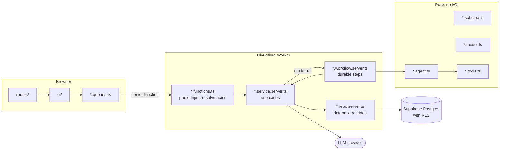

<p align="center">
  
</p>

<h1 align="center">Touch Grass</h1>

<p align="center">
  <strong>An opinionated TypeScript scaffold for coding agents, so you can go touch grass.</strong>
</p>

<p align="center">
  
  
  
  
  
  
</p>

<p align="center">
  <a href="#quickstart">Quickstart</a> · <a href="#architecture">Architecture</a> · <a href="skills/touch-grass/references/deploy.md">Deploy guide</a>
</p>

Touch Grass is a template that makes it easy for coding agents to make the right choices. Its TypeScript scaffold catches mistakes early, and pre-installed skills help you get higher-quality code from every prompt. It also provisions an opinionated stack on Cloudflare, Supabase, the OpenAI Agents SDK, and Langfuse. Less plumbing, more fun shipping agents.

Note: For deployment, you'll need to approve the Cloudflare, Supabase and Google sign-ins and paste your LLM key into a hidden prompt. Secrets never make it into the context window.

## Quickstart

1. **Check the prerequisites.**
   - **Locally:** a coding agent that loads skills (Codex or Claude Code), Node.js >=22.23 and Git. Local verification also needs Docker and Google Chrome.
   - **Accounts:** Cloudflare, Supabase and Google Cloud accounts, and an LLM API key. Google sign-in stays in Testing mode for listed test users; publishing it needs your homepage and privacy policy.
2. **Create an empty private repository** on your Git host and clone it with Git credentials that can push to it.
3. **Install the skill** from the clone's root with the [skills CLI](https://github.com/vercel-labs/skills):

   ```sh
   npx skills add Brgraul/touch-grass
   ```

4. **Invoke the skill** from the clone's root:

   ```text
   $touch-grass
   ```

## A codebase your coding agents will love

Inspired by the principles behind Dune, the internal agent-first app framework that Lauren (@poteto) [walked through](https://x.com/poteto/status/2102050467505430555) in her breakdown of the engineering workflow at xAI.

- **Verifiable.** `pnpm check` runs the type checker, the lint rules, the import boundaries and every test suite. Correctness is enforced deterministically.
- **Senior-engineer skills.** The bundled skills make agents work like a senior engineer: plan first, test as they go, and prove the change works before reporting success.
- **Agent-friendly architecture.** The app is split by feature, and a file's name gives it one job. Lint rules enforce boundaries, so code in the wrong place fails the build. Four principles motivate the structure:
  - **Context locality.** A change to one feature stays in that feature's folder, so the agent doesn't wander around.
  - **Separation of concerns.** Screens, data fetching, business logic and database access live in separate files.
  - **State consistency.** Every piece of application state has a single valid writer to prevent conflicting updates.
  - **Runtime isolation.** Separating client, server, and worker code helps maintain performance and reduces unnecessary coupling.

## Architecture

The app is organized by feature. Each file's suffix gives it a role, and each role may import only what the policy allows. This is a simplified view of one feature:



## Don't ask, enforce

Rules in a prompt are suggestions. Rules that fail the build are not. The generated app enforces its architecture with:

- **Import boundaries.** dependency-cruiser checks every import against the role allowlist, and fails on cross-feature imports and feature cycles.
- **Policy lint rules.** Custom rules keep schemas, models, tools and agents free of I/O, clocks and randomness. They keep fetching out of UI components, environment reads in one module, and brand casts in parsers.
- **Anti-slop lint for TypeScript.** 18 Oxlint rules reject the patterns agents tend to produce: chained type assertions, `unknown` parameters and returns, widen-then-assert, module mocking, object parameters and more.
- **Client bundle inspection.** The production build fails if a server module, server package, private environment name or planted secret reaches a browser chunk.
- **Repository checks.** Exact version pins, a banned-package list, an append-only migration ledger, a generated `ARCHITECTURE.md` that must match the policy, and hash-verified vendored skills.

`pnpm check` runs all of it, plus type checking and every test suite, against a freshly reset local database.

## Agent skills

The template vendors agent skills pinned to upstream commits. They keep engineering judgment in front of the code instead of replacing it:

- **[pstack](https://github.com/michael-denyer/pstack-claude)**, poteto's skill stack. `poteto-mode` routes work to playbooks for features, bugs, refactors and reviews, and requires proof before an agent reports success. Includes `architect`, `tdd`, `interrogate`, `correct` and `bro`.
- **[`grill-me`](https://github.com/mattpocock/skills)** from Matt Pocock: a relentless interview that sharpens a plan before any code exists.
- **[`show-me`](https://github.com/humanlayer/skills)** from HumanLayer: explains the current topic with diagrams and focused visual sketches.
- **[`vercel-react-best-practices`](https://github.com/vercel-labs/agent-skills)** and a provider-neutral **`evals`** skill for measuring LLM features.
- **evals**: A vendor-neutral skill for generating and improving best-practices evals.

## Batteries included

| Included | What you get |
| --- | --- |
| **TanStack Start** | React, TypeScript, and TanStack Query for the application. |
| **Tailwind CSS v4 + shadcn/ui** | Styling and accessible UI components you own. |
| **Cloudflare Workers + Workflows** | App hosting and durable background tasks. |
| **Supabase** | PostgreSQL, authentication, and file storage. |
| **Tests, CI, and `AGENTS.md`** | A starter built for coding agents. |
| **Pinned agent skills** | Systematic debugging, verification before completion, and React best practices. |
| **Resumable setup** | Rerun `$touch-grass` in the generated repo to verify it again and finish the deploy, without bootstrapping it again. |
